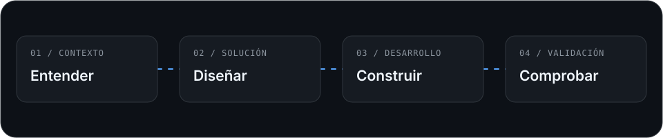

<h1 align="center">Luis Ramos</h1>

  <strong>Desarrollador Fullstack Junior · Python, Django y React</strong>

  Interfaces, APIs y bases de datos para resolver necesidades concretas. 
  Egresado de Ingeniería de Sistemas · Lambayeque, Perú

  <a href="https://luisramosdev.com/">Portafolio</a>
  &nbsp;·&nbsp;
  <a href="https://luisramosdev.com/resume">CV</a>
  &nbsp;·&nbsp;
  <a href="https://www.linkedin.com/in/luis-angel-ramos-chiroque-36b21b257/">LinkedIn</a>
  &nbsp;·&nbsp;
  <a href="mailto:ramoschiroqueluis3@gmail.com">Correo</a>

  

## Sobre mí

Tengo experiencia de prácticas contribuyendo al desarrollo de un ERP
con **Django, Django REST Framework y React**.

He trabajado en formularios, integración de APIs, validaciones de negocio
y funcionalidades de ventas, inventario y producción. También he desarrollado
proyectos académicos de gestión e integración de servicios.

Busco oportunidades de **prácticas y desarrollo fullstack junior** donde pueda
aportar al equipo, recibir feedback y seguir fortaleciendo mis conocimientos.

## Experiencia práctica

**Practicante de Desarrollo de Software · Sysflexify Technologies S.A.C**  
Noviembre de 2025 – octubre de 2026

- Contribuí al desarrollo de funcionalidades de ventas, inventario y producción.
- Implementé validaciones de crédito, pagos parciales y controles para prevenir órdenes duplicadas.
- Desarrollé formularios con React y TypeScript integrados con la API del backend.
- Implementé funcionalidades de envasado y exportación del Kardex a Excel.
- Utilicé Git y GitHub para registrar cambios, resolver conflictos y colaborar mediante pull requests.

## Proyectos seleccionados

### 01 · Gestión de Semilleros de Investigación

Aplicación web para centralizar procesos administrativos y solicitudes
de semilleros de investigación.

**Mi aportación:** flujos de estados, permisos por rol, interfaz responsiva
y pruebas automatizadas de formularios, reglas de negocio y autorización.

**Tecnologías:** Python · Django · PostgreSQL · Tailwind CSS · HTMX · Alpine.js

[Ver el proyecto y sus interfaces →](https://luisramosdev.com/portfolio/semilleros-unprg)

### 02 · Perfil Docente 360

Aplicación para consolidar información académica y facilitar su consulta
y exportación como currículum.

**Mi aportación:** integración entre frontend y API, procesamiento de extracción
de datos con Redis y Python, paneles de visualización y vista de impresión A4.

**Tecnologías:** Next.js · NestJS · Python · PostgreSQL · Redis

[Explorar el proyecto →](https://luisramosdev.com/portfolio/perfil-docente-360)

### 03 · Portafolio profesional

Sitio publicado para presentar mi experiencia, proyectos y perfil profesional.

**Mi aportación:** interfaz responsiva, animaciones, formulario con validación
en el servidor, integración con Resend y configuración del despliegue con dominio
propio y HTTPS.

**Tecnologías:** Next.js · React · TypeScript · Tailwind CSS · Framer Motion · Netlify

[Visitar el portafolio →](https://luisramosdev.com/)

## Tecnologías

| Área | Tecnologías y herramientas |
| :--- | :--- |
| **Backend** | Python · Django · Django REST Framework · APIs REST |
| **Frontend** | JavaScript · TypeScript · React · Next.js · HTML · CSS · Tailwind CSS |
| **Datos** | SQL · PostgreSQL · Supabase |
| **Herramientas** | Git · GitHub · Postman · Docker |
| **Diseño** | Figma |

<strong>Herramientas utilizadas en otros proyectos</strong>

También he trabajado con FastAPI, NestJS, Redis, HTMX y Alpine.js
en proyectos específicos. En las fichas del portafolio explico
el contexto en el que utilicé cada herramienta.

## Cómo trabajo y qué estoy reforzando

Procuro entender la necesidad, dividirla en tareas pequeñas y comprobar
el comportamiento de cada funcionalidad antes de darla por terminada.

Actualmente estoy reforzando:

- Fundamentos de JavaScript, TypeScript y React.
- Consultas SQL y modelado de datos.
- Autenticación, permisos y validación de APIs.
- Pruebas automatizadas y depuración.
- Comunicación de decisiones y colaboración mediante revisión de código.

## Conversemos

Me interesa participar en equipos donde pueda contribuir al desarrollo
de aplicaciones web y continuar aprendiendo.

**[Portafolio](https://luisramosdev.com/)** ·
**[CV](https://luisramosdev.com/resume)** ·
**[LinkedIn](https://www.linkedin.com/in/luis-angel-ramos-chiroque-36b21b257/)** ·
**[Correo](mailto:ramoschiroqueluis3@gmail.com)**
